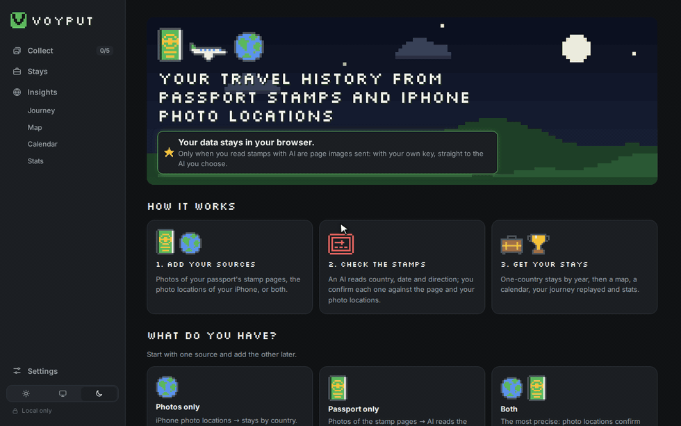

# voyput



Passport stamps + iPhone photo locations → your travel history. Runs in browser. Data stays in browser.

**Try:** https://voyput.app.offcall.link (demo data, no key needed)

## How it works

1. Add photos of passport stamp pages, iPhone photo locations CSV, or both.
2. AI reads stamps: country, date, direction. You check each against the page and your photo locations.
3. Get one-country stays. Edit, split, approve.
4. See Journey replay, map, calendar, stats.

## Private

- Everything in this browser (IndexedDB). No account, no voyput server, no analytics.
- Stamp reading sends page images to the AI you pick, with your own key: [OpenRouter](https://openrouter.ai/keys), or your local Claude Code / Codex CLI via `voyput-local` (below).
- Photo locations CSV from your Mac: [`tools/photos-export`](tools/photos-export). Reads Photos library locally, uploads nothing.

## Read stamps with your Claude Code / Codex subscription

```bash
curl -fsSL https://voyput.app.offcall.link/voyput-local.mjs -o voyput-local.mjs && node voyput-local.mjs
```

Node 22.12+. Listens on 127.0.0.1 only. Open the pairing link it prints. Requests signed, photos encrypted. Safari may block it; use Chrome or Firefox. Details: [ADR 0026](docs/adr/0026-local-ai-engine.md).

## Dev

```bash
npm install
npm run dev     # http://127.0.0.1:5173
npm run check   # biome, tsc, tests
npm run build   # static site in apps/web/dist; serve index.html for unknown paths
```

Code: `apps/web` app · `packages/core` logic · `packages/ui` components · `packages/local` voyput-local · `tools/photos-export` CSV exporter. Decisions: [`docs/adr/`](docs/adr/README.md).

## License

[MIT](LICENSE). Wikimedia Commons sample pages in the demo keep their own licences: [credits](apps/web/public/demo/CREDITS.md).
